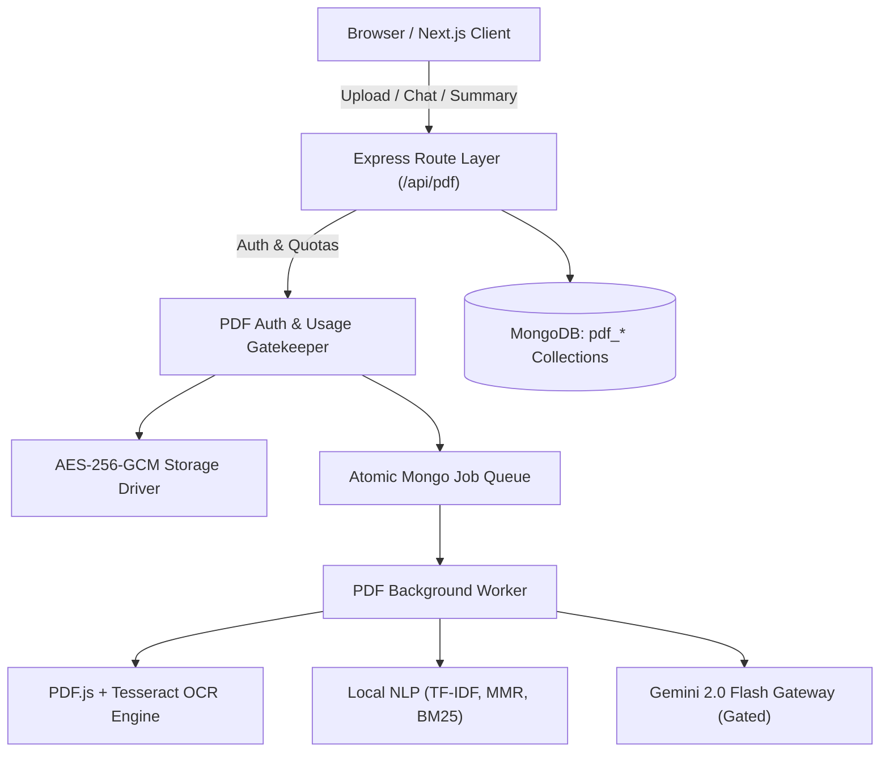

# TutoHub PDF Assistant – Production Architecture & Operations Manual

## 1. System Architecture Overview

TutoHub PDF Assistant is built as a modular domain package directly within TutoHub (`learning_backend/modules/pdf-assistant` and `learning_frontend/pages/pdf-assistant`).

### Key Components
1. **Isolated Private Storage (`storageService.js`)**:
   - Files are stored in a dedicated directory outside the public web root (`storage/pdf_documents/`).
   - Every file is encrypted on disk with **AES-256-GCM** using an IV and authentication tag (`[12B IV][16B Tag][Encrypted Data]`).
   - Files are streamed to the client only through verified ownership endpoints or signed single-use download links.
2. **Asynchronous Lease-Based Queue (`queueService.js`)**:
   - Queue jobs are stored in `pdf_processing_jobs` with atomic lease locks (`lockedBy`, `lockExpiresAt`).
   - Handles multi-attempt retries with exponential backoff and idempotency keys.
   - Run mode: inline by default or dedicated worker process (`PDF_WORKER_MODE=separate`).
3. **Local-First Extraction & Intelligence (`pdfExtractor.js`, `localNlpService.js`)**:
   - Mozilla `pdfjs-dist` parses text, metadata, table of contents outlines, and security flags (`/JavaScript`, `/EmbeddedFiles`, `/Launch`).
   - Local TF-IDF + MMR (Maximal Marginal Relevance) generates structured executive summaries and revision notes.
   - BM25 passage indexer performs local semantic search for Q&A without incurring AI API token costs.
4. **Budget-Guarded AI Gateway (`aiService.js`)**:
   - Integrated with Google Gemini 2.0 Flash via server-side credentials only.
   - Guarded by hard daily budget limits (`PDF_AI_DAILY_BUDGET_USD`).
   - Enforces prompt injection protection: document excerpts are isolated as untrusted data.
   - If information does not exist in the document, returns `found: false` with zero hallucination.
5. **Usage & Monetization Layer (`usageService.js`, `plans.js`)**:
   - Centralized tier configurations (Guest, Free, Pro Premium).
   - Atomic daily quota counters in `pdf_usage_counters` (uploads, AI queries, OCR pages).
   - Pre-launch waitlist engine ready to hook into Razorpay or Stripe.

---

## 2. Environment Variables & Configuration

### Backend (`learning_backend/.env`)
| Variable | Default | Purpose |
|---|---|---|
| `PDF_STORAGE_DIR` | `./storage/pdf_documents` | Private folder for encrypted PDFs |
| `PDF_STORAGE_DRIVER` | `local` | `local` (or `s3` for AWS S3 / Cloudflare R2) |
| `PDF_ENCRYPTION_KEY` | Derived from `JWT_SECRET` | 32-byte hex key for AES-256-GCM |
| `PDF_WORKER_MODE` | `inline` | `inline` (same process) or `separate` (dedicated queue worker) |
| `PDF_AI_DAILY_BUDGET_USD` | `10.0` | Maximum daily spend allowed on Gemini API |
| `GOOGLE_API_KEY` | Current Gemini Key | Server-side Gemini API key |

### Frontend (`learning_frontend/.env`)
| Variable | Value | Purpose |
|---|---|---|
| `NEXT_PUBLIC_API_URL` | `http://localhost:5000/api/` | Base URL for backend API |
| `NEXT_PUBLIC_SITE_URL` | `https://tutohub.com` | Base URL for canonical SEO & OpenGraph |

---

## 3. Estimated Operating Costs & Capacity

| Resource | Free Tier Cost | Scale (10,000 DAU) |
|---|---|---|
| **PDF Text Extraction** | $0 (Runs locally on CPU) | $0 |
| **Local Summaries & Quizzes** | $0 (Pure JS NLP) | $0 |
| **Storage (Encrypted)** | $0 (Local disk / 10GB free R2) | ~$0.015 / GB on Cloudflare R2 (zero egress fees) |
| **AI Q&A (Gemini 2.0 Flash)** | ~$0.0003 per query | ~$15 / month (under rate-limited quotas & local BM25 pre-filtering) |
| **Total Baseline Cost** | **$0 / month** | **<$50 / month** |

---

## 4. Testing Results

The automated Jest test suite verified 11 critical integration journeys:
- Public plan configurations and guest session token issuance.
- AES-256-GCM file upload, hash calculation, and automatic deduplication.
- Document extraction: page segmentation, metadata inspection, and outline discovery.
- In-document full-text search with exact offset highlighting.
- Local extractive summarization, definition extraction, and study note generation.
- Grounded document Q&A with verifiable page citations.
- Absence detection: correctly answering `found: false` without fabricating information.
- Document lifecycle: cascading permanent deletion of files, pages, and chat records.
